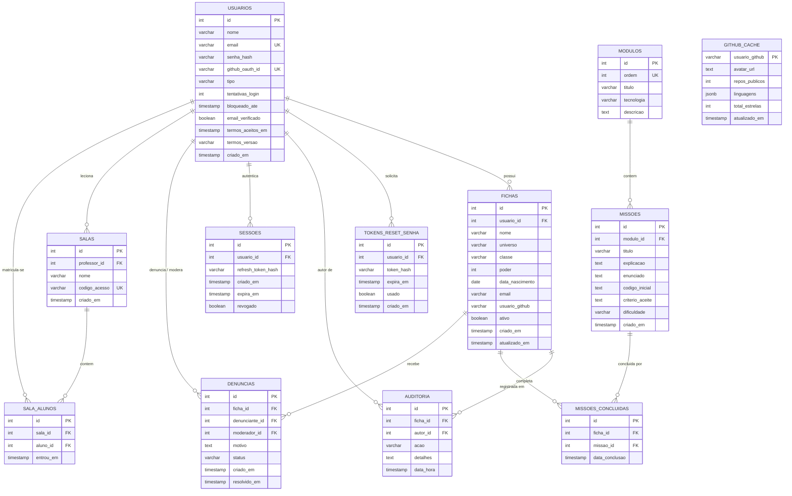

# CodeQuest — Especificação Técnica Final (Spec)

> **Documento de Especificação Técnica e Arquitetural do Projeto CodeQuest**  
> Elaborado rigorosamente conforme o template de 8 seções normativas do Anexo A da apostila de desenvolvimento.  
> **Status:** Versão Final Atualizada — Alinhada com o Schema Prisma, Rotas, Telas e Catálogo Oficial de Missões.

---

## 1. Objetivo

O **CodeQuest** é uma plataforma web gamificada projetada para resolver a falta de engajamento e a estagnação de desenvolvedores júniores e estudantes de TI em portfólios estáticos tradicionais (ex.: perfis simples do GitHub, arquivos README sem interação). 

A plataforma transforma o aprendizado prático de desenvolvimento de software em uma jornada de RPG (*Role-Playing Game*). Cada usuário gerencia uma **Ficha de Personagem** cujo atributo de **Poder de Combate (0–100)** evolui de maneira verificável e transparente por meio de dois pilares complementares:
1. **Conclusão de Missões Pedagógicas Práticas**: Desafios algorítmicos e de código estruturados em uma Trilha de Aprendizagem de 4 módulos encadeados (Programação em Blocos, Python, HTML5/CSS3 e JavaScript ES6+);
2. **Atividade Real e Verificada no GitHub**: Integração com a API do GitHub com cache relacional persistido, extraindo métricas públicas (repositórios, linguagens e estrelas acumuladas).

Além da progressão individual do estudante, o CodeQuest oferece ecossistemas completos para educadores (Salas de Aula Virtuais com acompanhamento de turmas), moderadores (Tribunal de Denúncias contra condutas abusivas) e administradores (Curadoria oficial de desafios didáticos e auditoria inviolável em conformidade com a LGPD).

---

## 2. Usuários

O sistema possui 5 perfis de usuários com níveis hierárquicos e permissões estritas de acesso:

1. **Visitante (Não Autenticado)**:
   - Navega pela vitrine pública de personagens ativos.
   - Aplica buscas textuais por nome/classe combinadas com filtros por universo.
   - Consulta o ranking público dos desenvolvedores mais poderosos.
   - Visualiza a ementa dos módulos da trilha de aprendizagem.

2. **Estudante / Desenvolvedor Júnior**:
   - Cria e autentica conta via e-mail/senha ou login social OAuth do GitHub.
   - Confirma seu endereço de e-mail e aceita obrigatoriamente os Termos de Uso e Política de Privacidade (LGPD).
   - Cadastra, visualiza, edita e arquiva/restaura sua própria ficha de personagem (respeitando a regra de no máximo 1 ficha ativa por conta).
   - Vincula seu nome de usuário do GitHub para enriquecer os atributos da ficha.
   - Percorre a Trilha de Aprendizagem, consulta o catálogo de missões com filtros por módulo e dificuldade, copia códigos iniciais e submete resoluções.
   - Denuncia personagens com nomes ou condutas impróprias e acompanha o status de sua denúncia.
   - Exerce o direito de portabilidade de dados pessoais via exportação em formato legível (JSON).

3. **Professor / Educador**:
   - Possui todos os privilégios do perfil Estudante.
   - Cria salas de aula virtuais temáticas com códigos de acesso alfanuméricos exclusivos.
   - Matricula e gerencia alunos em turmas, remove matrículas e acompanha a matriz de progresso pedagógico da turma.
   - Atribui desafios personalizados e exporta relatórios de desempenho em formato estruturado (CSV).

4. **Moderador de Conteúdo**:
   - Acessa a câmara de moderação e o painel de denúncias pendentes.
   - Analisa denúncias de fichas impróprias, deferindo-as como *procedentes* (com arquivamento compulsório da ficha) ou rejeitando-as como *improcedentes*, sempre com justificativa formal registrada em auditoria inviolável.
   - É impedido pelas regras de negócio de analisar denúncias vinculadas à sua própria ficha.

5. **Administrador / Curador Oficial**:
   - Acesso irrestrito a todas as áreas administrativas da plataforma.
   - Forja, cadastra, edita e gerencia as missões e módulos oficiais da Trilha Pedagógica.
   - Consulta e filtra as crônicas completas do log de auditoria imutável por ficha, autor, tipo de ação e período temporal.
   - Acompanha o painel de métricas agregadas do ecossistema (total de contas, personagens ativos, conclusões de missões e denúncias).
   - Executa suspensão e reativação disciplinar de contas de usuário e a exclusão definitiva por solicitação LGPD.
   - Reverte arquivamentos decorrentes de deliberações disciplinares de moderação.

---

## 3. Casos de Uso Principais

* **UC01 — Autenticação e Gestão de Conta**: Cadastro de usuário com validação de senha, aceite de termos de privacidade LGPD, confirmação de e-mail, login seguro com cookie `HttpOnly`, logout de sessão única ou encerramento global de sessões ativas.
* **UC02 — Recuperação Segura de Acesso**: Solicitação de redefinição de senha com limitação de taxa (*rate limit*), token criptográfico de uso único com expiração em 1 hora e gravação de tentativa bloqueada em auditoria.
* **UC03 — Gestão da Ficha de Personagem**: Criação de personagem com nome, classe, universo temático (7 opções permitidas), poder inicial (0–100) e username do GitHub, garantindo unicidade de 1 ficha ativa por usuário.
* **UC04 — Ciclo de Vida da Ficha (Arquivamento e Restauração)**: Exclusão lógica (`ativo = false`) com confirmação explícita em modal; restauração de personagem arquivado arquivando automaticamente o personagem ativo prévio na mesma transação.
* **UC05 — Busca e Navegação no Mural Público**: Listagem paginada (10 itens/página) de personagens ativos, com ordenação padrão por nome e filtros combinados por texto e universo.
* **UC06 — Consulta de Métricas do GitHub**: Exibição resiliente de repositórios, linguagens e estrelas a partir de cache relacional (`github_cache`, expiração de 1h), tolerando falhas externas e timeout de 3 segundos sem travar a interface.
* **UC07 — Navegação pela Trilha Pedagógica**: Acesso não-linear aos 4 módulos encadeados (Blocos → Python → HTML/CSS → JavaScript), permitindo consultar ementas e competências técnicas.
* **UC08 — Consulta e Filtro do Catálogo de Missões**: Filtragem dos desafios práticos por módulo e por dificuldade (Fácil, Médio, Difícil), visualizando enunciados, código template e critérios de aceite.
* **UC09 — Submissão e Registro de Conclusão de Missão**: Submissão da resolução do desafio, gravação única por ficha na tabela `missoes_concluidas` e feedback visual instantâneo com toast e atualização de poder.
* **UC10 — Curadoria Oficial de Missões**: Administrador cadastra novos desafios no catálogo oficial com título, enunciado, código template, critério de validação e nível de dificuldade, gerando log em auditoria.
* **UC11 — Moderação de Conteúdo e Tribunal de Denúncias**: Estudante denuncia ficha ofensiva; moderador examina o motivo e decide pela procedência (arquivando a ficha) ou improcedência, com justificativa obrigatória.
* **UC12 — Reversão Administrativa de Moderação**: Administrador analisa ficha arquivada por denúncia e, se justificado, restaura seu status ativo, privilégio negado a moderadores comuns.
* **UC13 — Consulta ao Log Inviolável de Auditoria**: Administrador filtra o histórico completo de mutações do banco de dados por ficha, autor, tipo de ação e janela temporal (24h, 7d, 30d).
* **UC14 — Gestão de Salas de Aula Virtuais**: Professor cria sala virtual, gera código de acesso único, matricula/remove alunos e acompanha a matriz de resolução de missões.
* **UC15 — Privacidade e Portabilidade LGPD**: Usuário exporta todos os seus dados cadastrais, fichas, auditorias e histórico de missões em arquivo JSON legível.

---

## 4. Requisitos Funcionais

### Módulo A — Conta e Autenticação
* **RF01a** — Cadastro e login por e-mail e senha com hash seguro (`bcryptjs` com custo $\ge 10$), sessão persistida via cookie seguro (`HttpOnly`, `Secure`, `SameSite=Strict`), bloqueio temporário após 5 tentativas incorretas consecutivas e fluxo de "esqueci minha senha" com token de uso único (expiração de 1 hora) limitado a 1 solicitação a cada 2 minutos por e-mail/IP. *(MVP)*
* **RF01b** — Login social via OAuth do GitHub com suporte a contas sem senha prévia, associando a conta automaticamente à ficha existente caso haja `usuario_github` idêntico. *(V2)*
* **RF01c** — Verificação obrigatória de e-mail com token temporário; contas pendentes de confirmação em até 7 dias têm bloqueado o acesso a mutações de ficha (criar, editar, arquivar, restaurar). *(MVP)*
* **RF01d** — Edição cadastral dos dados da conta (nome, e-mail e senha) pelo próprio usuário logado; alterar o e-mail exige nova verificação de segurança antes de liberar autenticações futuras. *(MVP)*
* **RF01e** — Encerramento de sessão atual (`/api/auth/logout`) e opção "Encerrar todas as sessões", que revoga todos os refresh tokens ativos do usuário na tabela `sessoes`. *(MVP)*
* **RF01f** — Aceite obrigatório dos Termos de Uso e da Política de Privacidade no momento do cadastro (checkbox não pré-marcado), gravando `timestamp` e a versão do termo aceito em conformidade com a LGPD. *(MVP)*
* **RF01g** — Exclusão da própria conta mediante reautenticação explícita de senha, disparando a rotina de anonimização e exclusão definitiva prevista na LGPD. *(V2)*

### Módulo B — Ficha de Personagem
* **RF02** — Cadastro de ficha de personagem contendo: `nome` (2 a 100 caracteres), `universo` (lista fechada), `classe`, `poder` (0 a 100), `data_nascimento` (opcional), `email` de exibição (opcional) e `usuario_github` (opcional). Bloqueado se o usuário já possuir outra ficha ativa. *(MVP)*
* **RF03** — Restrição estrita de universos permitidos aos 7 valores canônicos: **Marvel**, **DC**, **Star Wars**, **Tolkien**, **D&D**, **Anime** e **Games**. *(MVP)*
* **RF04** — Validação bidirecional (cliente com schemas Zod e servidor nas rotas de API), com retenção de campos preenchidos e indicação visual de erro caso ocorra falha. *(MVP)*
* **RF05** — Exclusão lógica (arquivamento) da ficha via `ativo = false`, exigindo confirmação explícita em modal antes da efetivação e removendo o personagem da vitrine pública. *(MVP)*
* **RF06** — Restauração de ficha arquivada; se o usuário já possuir outra ficha ativa no momento da restauração, a ficha ativa atual é arquivada automaticamente na mesma transação. *(MVP)*

### Módulo C — Navegação, Listagem e Busca
* **RF07** — Listagem paginada (10 personagens por página) no mural de personagens ativos, exibindo nome, classe, universo, avatar do GitHub e barra de poder. *(MVP)*
* **RF07a** — Seletor de ordenação alternativa na listagem pública: ordenação por nome (padrão alfabético), por poder (decrescente) ou por data de criação (mais recentes primeiro). *(V2)*
* **RF08** — Mecanismo de busca textual por nome e classe, combinável em tempo real com filtro por universo temático, exibindo estado vazio amigável quando nenhum resultado for retornado. *(MVP)*
* **RF09** — Área restrita e dedicada para visualização das fichas arquivadas do próprio usuário (`/fichas/arquivadas`), com ação de restauração imediata. *(MVP)*

### Módulo D — Integração com a API do GitHub
* **RF10** — Validação do formato do nome de usuário do GitHub no cliente e no servidor através de expressão regular oficial (`^[a-zA-Z0-9](?:[a-zA-Z0-9]|-(?=[a-zA-Z0-9])){0,38}$`). *(MVP)*
* **RF11** — Exibição de métricas públicas sincronizadas da conta do GitHub vinculada: avatar oficial, contagem de repositórios públicos, linguagens mais utilizadas e total de estrelas acumuladas. *(MVP)*
* **RF12** — Timeout de 3 segundos na consulta externa à API do GitHub e persistência em cache relacional (`github_cache`) com validade de 1 hora; em caso de falha externa ou limite de taxa atingido, o sistema mantém os dados cadastrais da ficha e exibe aviso amigável sem quebrar a renderização. *(MVP)*
* **RF12a** — Revalidação assíncrona do cache expirado em segundo plano: a interface exibe as métricas cacheadas com indicador visual de sincronização sem bloquear o carregamento da página. *(V2)*
* **RF12b** — Botão manual "Atualizar" na visualização da ficha para revalidação imediata do cache do GitHub, limitado por taxa a 1 uso por usuário a cada 5 minutos. *(V2)*

### Módulo E — Trilha de Aprendizagem e Catálogo Oficial de Missões
* **RF13** — Trilha pedagógica estruturada em 4 módulos sequenciais navegáveis: **Módulo 1 — Programação em Blocos**, **Módulo 2 — Python**, **Módulo 3 — HTML e CSS** e **Módulo 4 — JavaScript**. *(MVP)*
* **RF13a** — Exibição das competências técnicas, ementa detalhada e percentual de progresso concluído em cada módulo. *(V2)*
* **RF14** — Catálogo oficial de missões pedagógicas contendo título, módulo vinculado, enunciado do desafio, template de código inicial, critério de aceite e nível de dificuldade. *(V2)*
* **RF14a** — Interface do catálogo de missões (`/missoes`) com filtros combinados em tempo real por nível de dificuldade (Fácil, Médio, Difícil) e por módulo da trilha. *(V2)*
* **RF15** — Submissão de solução de missões com registro único por ficha na tabela `missoes_concluidas`, impedindo submissões duplicadas e incrementando o poder de combate do personagem. *(V2)*
* **RF15a** — Validação automática de submissões via Webhook do GitHub com verificação obrigatória de assinatura criptográfica HMAC SHA-256 no header `X-Hub-Signature-256`, rejeitando payloads adulterados ou sem assinatura válida. *(V2)*
* **RF15b** — Consulta ao histórico individual de missões completadas pelo desenvolvedor na visualização detalhada da ficha e na tela da missão. *(V2)*

#### Catálogo Oficial das 24 Missões da Trilha Pedagógica (6 Desafios por Módulo com Base Conceitual)

### Módulo 1 — Programação em Blocos

##### Missão 1: O Despertar dos Blocos Mágicos
- **ID**: `1` | **Módulo**: `1` (Módulo 1 — Programação em Blocos)
- **Dificuldade**: `facil` (Fácil)
- **Grimório Teórico & Explicação Conceitual**:
  > Antes de conjurar algoritmos complexos, todo aprendiz deve compreender que a programação é uma sequência ordenada e finita de instruções que transformam entradas em saídas previsíveis. No paradigma visual de blocos, o fluxo de execução é controlado por duas estruturas vitais:
  > 1. Estruturas de Repetição (enquanto / while): Avaliam continuamente uma condição lógica. Enquanto a condição for verdadeira (caminhoLivre() == true), o bloco interno é executado repetidamente.
  > 2. Estruturas de Decisão (se / if): Permitem que o herói reaja a imprevistos no ambiente, executando ações especiais (como desarmar uma armadilha) apenas quando uma contingência é detectada.
  > Compreender o encadeamento correto de repetição e decisão é a fundação para evitar loops infinitos e travamentos em qualquer linguagem moderna.
- **Enunciado do Desafio**:
  Nas ruínas ancestrais de Algoritmia, o herói precisa atravessar um corredor repleto de armadilhas para alcançar o Baú de Runas Sagradas. Monte uma sequência algorítmica visual utilizando estruturas de repetição e verificações condicionais: enquanto o caminho à frente estiver livre, o personagem deve avançar uma casa; caso encontre um obstáculo mágico, deve desarmá-lo antes de prosseguir; ao atingir a câmara final, deve abrir o baú para coletar o fragmento de código.
- **Código Inicial (Template)**:
  ```text
  // Algoritmo Visual de Blocos
  enquanto (caminhoLivre()) {
    andarFrente();
    se (detectarArmadilha()) {
      desarmarArmadilha();
    }
  }
  se (alcancouBau()) {
    abrirBau();
  }
  ```
- **Critério de Aceite**:
  *O algoritmo deve guiar o herói pelo labirinto alcançando o baú em no máximo 10 iterações, sem colidir com obstáculos e desarmando todas as armadilhas encontradas.*

##### Missão 2: A Coleta das Gemas Elementais
- **ID**: `2` | **Módulo**: `1` (Módulo 1 — Programação em Blocos)
- **Dificuldade**: `facil` (Fácil)
- **Grimório Teórico & Explicação Conceitual**:
  > Muitas vezes conhecemos de antemão o número exato de repetições necessárias. Para isso, utilizamos Laços Contados (laço para / for), acompanhados de uma Variável Acumuladora:
  > 1. Contador de Passos (para pilar de 1 até N): Uma variável de controle que incrementa a cada ciclo até atingir o limite estipulado.
  > 2. Variável Acumuladora (totalGemas = totalGemas + 1): Armazena e preserva o estado ao longo das iterações da jornada.
  > Dominar laços contados evita erros clássicos de "deslocamento por um" (off-by-one errors) e garante que o processamento termine exatamente após o último elemento planejado.
- **Enunciado do Desafio**:
  Uma ponte suspensa de 5 pilares arcanos estende-se sobre o abismo do esquecimento. Em cada pilar repousa uma gema elemental brilhante. Construa um algoritmo em blocos com um laço contado de 1 a 5: para cada pilar, o herói deve avançar, conjurar o feitiço de coleta e incrementar a variável acumuladora gemasColetadas. Ao final da ponte, retorne o total acumulado.
- **Código Inicial (Template)**:
  ```text
  // Coleta das Gemas com Laço Contado
  let gemasColetadas = 0;
  
  para (let pilar = 1; pilar <= 5; pilar++) {
    andarFrente();
    coletarGema();
    gemasColetadas = gemasColetadas + 1;
  }
  
  notificarGuilda("Total de gemas coletadas:", gemasColetadas);
  ```
- **Critério de Aceite**:
  *O herói deve percorrer exatamente os 5 pilares da ponte e acumular 5 gemas no inventário ao final da travessia sem passos redundantes.*

##### Missão 3: O Labirinto das Bifurcações Rúnicas
- **ID**: `3` | **Módulo**: `1` (Módulo 1 — Programação em Blocos)
- **Dificuldade**: `medio` (Médio)
- **Grimório Teórico & Explicação Conceitual**:
  > Quando o herói se depara com decisões com mais de dois desfechos possíveis, o simples se/senão torna-se insuficiente. Entram em cena as Estruturas Condicionais Encadeadas (se / senão-se / senão) e os Operadores Lógicos (E, OU, NÃO):
  > - se (if): Avalia o primeiro caso prioritário.
  > - senão-se (else if): Avalia casos secundários caso o primeiro seja falso.
  > - senão (else): O caminho padrão executado se nenhuma das alternativas anteriores for satisfeita.
  > Em sistemas reais, isso é análogo ao tratamento de múltiplos estados de conexão HTTP ou permissões de usuário (estudante, professor, moderador, admin).
- **Enunciado do Desafio**:
  O herói chega à Câmara dos Três Portais Rúnicos. Cada bifurcação emite uma aura mágica diferente que exige um feitiço específico: se a luz emitida for azul (gelo), deve conjurar Chama Arcana; senão se a luz for vermelha (fogo), deve conjurar Orbe de Gelo; caso contrário (luz neutra), deve conjurar Escudo de Vento e passar em silêncio. Escreva a lógica para desarmar 4 bifurcações consecutivas.
- **Código Inicial (Template)**:
  ```text
  // Estrutura Condicional Encadeada
  funcao resolverBifurcacao(corLuz) {
    se (corLuz === "azul") {
      conjurarChamaArcana();
    } senao se (corLuz === "vermelha") {
      conjurarOrbeGelo();
    } senao {
      conjurarEscudoVento();
    }
    avancarProximaCamara();
  }
  ```
- **Critério de Aceite**:
  *O algoritmo deve identificar corretamente as cores emitidas pelas 4 bifurcações, conjurando a magia exata para cada uma sem sofrer penalidade de vida.*

##### Missão 4: O Desarme dos Autômatos de Guarda
- **ID**: `4` | **Módulo**: `1` (Módulo 1 — Programação em Blocos)
- **Dificuldade**: `medio` (Médio)
- **Grimório Teórico & Explicação Conceitual**:
  > A repetição desnecessária de código é um dos maiores problemas na engenharia de software (princípio DRY: Don't Repeat Yourself). Para combater isso na programação visual, agrupamos rotinas em Procedimentos e Funções Modulares:
  > 1. Declaração do Procedimento: Define um bloco reutilizável com um nome descritivo e parâmetros de entrada.
  > 2. Parâmetros: Valores passados para o procedimento que personalizam seu comportamento interno.
  > 3. Invocação (Chamada): O herói reutiliza a mesma lógica para desarmar múltiplos autômatos sem duplicar blocos na tela.
- **Enunciado do Desafio**:
  Dois autômatos colossais guardam os portões da cidadela: um feito de ferro e outro de cristal. Cada um exige uma sequência de giros rúnicos de acordo com seu material. Crie um procedimento modular desarmarAutomato(tipo) que recebe o material como parâmetro e realiza a sequência adequada, invocando-o para ambos os guardas.
- **Código Inicial (Template)**:
  ```text
  // Procedimento Modular Reutilizável
  funcao desarmarAutomato(tipo) {
    se (tipo === "ferro") {
      girarChave("esquerda", 2);
      pressionarRuna("bronze");
    } senao {
      girarChave("direita", 3);
      pressionarRuna("ametista");
    }
  }
  
  // Desarmando os dois guardas do salão:
  desarmarAutomato("ferro");
  avancar();
  desarmarAutomato("cristal");
  ```
- **Critério de Aceite**:
  *A lógica de desarme deve estar encapsulada em um único procedimento reutilizável com parâmetros, sendo executada com sucesso contra os dois autômatos.*

##### Missão 5: A Travessia das Pontes Móveis
- **ID**: `5` | **Módulo**: `1` (Módulo 1 — Programação em Blocos)
- **Dificuldade**: `medio` (Médio)
- **Grimório Teórico & Explicação Conceitual**:
  > No desenvolvimento de sistemas reativos, frequentemente lidamos com Estados Transitórios e Sincronização Temporal. Uma ação não pode ocorrer antes que o ambiente externo atinja um estado seguro:
  > 1. Condições Compostas (E / &&): Exigem que múltiplos predicados sejam verdadeiros simultaneamente (ponteAbaixada() E tempoRestante >= 3).
  > 2. Espera Ativa Controlada (aguardar()): Pausa temporária enquanto a condição de travessia não estiver madura.
  > Essa lógica modela requisições que aguardam disponibilidade de recursos ou controle de fluxo em sistemas distribuídos.
- **Enunciado do Desafio**:
  O herói precisa atravessar 3 pontes levadiças mágicas que abrem e fecham em intervalos cronometrados. O algoritmo deve verificar se a ponte está abaixada e se há pelo menos 3 segundos de tempo seguro antes de iniciar o passo. Se o tempo for insuficiente, o herói deve aguardar o próximo ciclo.
- **Código Inicial (Template)**:
  ```text
  // Sincronização com Pontes Móveis
  para (let p = 1; p <= 3; p++) {
    enquanto (!ponteAbaixada() || obterTempoRestante() < 3) {
      aguardar(1);
    }
    atravessarPonte();
  }
  ```
- **Critério de Aceite**:
  *O herói deve cruzar as 3 pontes levadiças sem cair no abismo, garantindo travessia estritamente quando ponteAbaixada() for true e tempoRestante >= 3.*

##### Missão 6: O Guardião do Labirinto de Espelhos
- **ID**: `6` | **Módulo**: `1` (Módulo 1 — Programação em Blocos)
- **Dificuldade**: `dificil` (Difícil)
- **Grimório Teórico & Explicação Conceitual**:
  > Algoritmos clássicos de navegação autônoma em labirintos utilizam a Regra da Mão Direita (Wall Follower). Em qualquer labirinto 2D simplesmente conexo, manter a mão direita encostada na parede garante que o viajante encontrará a saída sem entrar em ciclos eternos.
  > Prioridade de decisão da máquina de estados a cada célula:
  > 1. Se houver caminho livre à direita: virar à direita e avançar.
  > 2. Senão, se o caminho à frente estiver livre: avançar.
  > 3. Senão, se houver caminho à esquerda: virar à esquerda e avançar.
  > 4. Caso esteja em um beco sem saída: dar meia-volta (180°).
  > Esse algoritmo introduz os fundamentos de inteligência artificial simbólica e robótica móvel.
- **Enunciado do Desafio**:
  O mago supremo desafia você a escapar do temido Labirinto de Espelhos de Algoritmia. Escreva um algoritmo autônomo baseado na Regra da Mão Direita que permita ao autômato navegar por corredores complexos e becos sem saída até encontrar o portal de teletransporte.
- **Código Inicial (Template)**:
  ```text
  // Algoritmo Autônomo da Regra da Mão Direita
  enquanto (!chegouAoPortal()) {
    se (ladoDireitoLivre()) {
      virarDireita();
      andarFrente();
    } senao se (frenteLivre()) {
      andarFrente();
    } senao se (ladoEsquerdoLivre()) {
      virarEsquerda();
      andarFrente();
    } senao {
      virarMeiaVolta();
    }
  }
  ```
- **Critério de Aceite**:
  *O autômato deve encontrar a saída do labirinto em no máximo 40 passos sem colidir e sem ficar preso em becos sem saída.*

### Módulo 2 — Python

##### Missão 7: O Cálculo do Dano Crítico
- **ID**: `7` | **Módulo**: `2` (Módulo 2 — Python)
- **Dificuldade**: `facil` (Fácil)
- **Grimório Teórico & Explicação Conceitual**:
  > Python é uma linguagem de altíssima legibilidade e tipagem dinâmica forte. A partir da PEP 484, o ecossistema adotou amplamente Type Hints (anotações de tipo) que tornam o código autodocumentado e seguro.
  > Pontos fundamentais desta missão:
  > 1. Assinatura de Função: Definida com def nome_funcao(arg: tipo) -> tipo_retorno:.
  > 2. Docstrings (PEP 257): Documentação em bloco com aspas triplas descrevendo argumentos e retorno.
  > 3. Cálculos Aritméticos e Arredondamento: Operações de multiplicação (*), soma (+) e arredondamento com round() ou int().
  > 4. Condicionais e Função max(): Assegurar que o valor retornado respeite limites mínimos (por exemplo, nunca ser negativo com max(0, valor)).
- **Enunciado do Desafio**:
  Na taverna dos magos de batalha, os aventureiros necessitam de um cálculo preciso do dano de suas magias elementais contra chefes de masmorra. Escreva em Python a função calcular_dano(ataque_base: int, multiplicador: float, bonus: int) -> int que recebe os pontos de ataque base, um multiplicador de acerto crítico e um bônus numérico. Se o multiplicador for estritamente superior a 1.5, o valor de bônus deve ser somado antes de aplicar o arredondamento final. O dano resultante nunca pode ser negativo e deve retornar como um número inteiro.
- **Código Inicial (Template)**:
  ```python
  def calcular_dano(ataque_base: int, multiplicador: float, bonus: int) -> int:
      """Calcula o dano final desferido pelo herói contra criaturas sombrias.
      
      Args:
          ataque_base: Força inicial do golpe (inteiro >= 0).
          multiplicador: Fator crítico (float >= 1.0).
          bonus: Valor adicional concedido por runas e equipamentos.
      
      Returns:
          Dano total resultante em número inteiro não-negativo.
      """
      # TODO: Implemente a lógica do cálculo de dano aqui
      pass
  ```
- **Critério de Aceite**:
  *A função deve retornar um número inteiro (int), arredondar valores fracionários corretamente, aplicar o bônus apenas quando o multiplicador for maior que 1.5 e garantir resultado >= 0 em todos os casos de teste.*

##### Missão 8: O Filtro de Poções do Boticário
- **ID**: `8` | **Módulo**: `2` (Módulo 2 — Python)
- **Dificuldade**: `facil` (Fácil)
- **Grimório Teórico & Explicação Conceitual**:
  > A manipulação de coleções de dados é o coração de qualquer aplicação backend. Em Python, a técnica mais idiomática e eficiente para filtrar e transformar listas é a List Comprehension (compreensão de listas):
  > resultado = [expressao for item in colecao if condicao]
  > Neste desafio, trabalhamos com uma lista de dicionários (list[dict]). Para ordenar strings alfabeticamente, usamos a função embutida sorted(lista) ou o método lista.sort(). Escrever código pythônico significa priorizar compreensões de listas em vez de loops for manuais com múltiplos .append().
- **Enunciado do Desafio**:
  O boticário de Valfenda precisa catalogar seu estoque de poções para a guilda. Crie a função filtrar_pocoes_disponiveis(inventario: list[dict], nivel_minimo: int) -> list[str] que recebe uma lista de poções (onde cada poção possui "nome": str, "nivel": int e "em_estoque": bool) e retorna uma lista ordenada alfabeticamente contendo apenas os nomes das poções que estão em estoque (em_estoque == True) e cujo nível seja maior ou igual a nivel_minimo.
- **Código Inicial (Template)**:
  ```python
  def filtrar_pocoes_disponiveis(inventario: list[dict], nivel_minimo: int) -> list[str]:
      """Filtra poções disponíveis em estoque que atendem ao nível mínimo exigido.
      
      Args:
          inventario: Lista de dicionários com chaves 'nome', 'nivel', 'em_estoque'.
          nivel_minimo: Nível mínimo de maestria exigido (inteiro).
      
      Returns:
          Lista alfabética contendo os nomes das poções selecionadas.
      """
      # TODO: Use list comprehension para filtrar e ordene alfabeticamente com sorted()
      pass
  ```
- **Critério de Aceite**:
  *Retornar lista ordenada alfabeticamente com os nomes das poções onde em_estoque é True e nivel >= nivel_minimo; retornar lista vazia caso nenhuma poção atenda aos critérios.*

##### Missão 9: O Grimório de Fichas e Dicionários
- **ID**: `9` | **Módulo**: `2` (Módulo 2 — Python)
- **Dificuldade**: `medio` (Médio)
- **Grimório Teórico & Explicação Conceitual**:
  > Dicionários em Python (dict) são estruturas de associação chave-valor implementadas como tabelas hash de altíssimo desempenho O(1).
  > Nesta missão, exploramos:
  > 1. Acesso Seguro com .get(): Evita exceções KeyError fornecendo um valor padrão se a chave não existir.
  > 2. Agregações com sum() e len(): Métodos matemáticos nativos para calcular médias aritméticas.
  > 3. Identificação de Extremos (max(..., key=...)): A função max() aceita um argumento de função key (como lambda x: x["poder"]) para localizar o herói com maior pontuação em uma única linha elegante.
- **Enunciado do Desafio**:
  O escriba da guilda precisa de um relatório executivo sobre as fichas de personagens cadastradas. Implemente resumo_guilda(fichas: list[dict]) -> dict que recebe uma lista de fichas de personagens (cada uma contendo "nome", "classe", "poder" e "ativo") e retorna um dicionário com: "total_ativos" (contagem de fichas com ativo=True), "poder_medio" (média aritmética do poder das fichas ativas com 1 casa decimal) e "campeao_nome" (nome do personagem ativo de maior poder). Se não houver fichas ativas, retorne {"total_ativos": 0, "poder_medio": 0.0, "campeao_nome": None}.
- **Código Inicial (Template)**:
  ```python
  def resumo_guilda(fichas: list[dict]) -> dict:
      """Calcula estatísticas agregadas das fichas ativas da guilda.
      
      Args:
          fichas: Lista de personagens contendo 'nome', 'classe', 'poder', 'ativo'.
      
      Returns:
          Dicionário com 'total_ativos', 'poder_medio' e 'campeao_nome'.
      """
      # TODO: Filtre personagens ativos e calcule as agregações necessárias
      pass
  ```
- **Critério de Aceite**:
  *O dicionário retornado deve conter as 3 chaves exatas; calcular o poder médio com 1 casa decimal de precisão e retornar valores neutros padrão caso a lista esteja vazia ou sem fichas ativas.*

##### Missão 10: A Criptografia das Runas Antigas
- **ID**: `10` | **Módulo**: `2` (Módulo 2 — Python)
- **Dificuldade**: `medio` (Médio)
- **Grimório Teórico & Explicação Conceitual**:
  > A criptografia clássica por substituição (como a famosa Cifra de César) é um excelente exercício para compreender a representação binária e numérica de textos.
  > Conceitos chave em Python:
  > 1. Função ord(c): Retorna o código numérico ASCII/Unicode de um caractere (ex: ord("A") == 65).
  > 2. Função chr(n): Converte o código numérico de volta para o caractere original (ex: chr(65) == "A").
  > 3. Aritmética Modular (% 26): Garante que o deslocamento do alfabeto seja circular — passar de "Z" retorna para "A".
  > 4. Imutabilidade de Strings: Em Python, textos são imutáveis; strings cifradas são construídas acumulando caracteres ou utilizando "".join(...).
- **Enunciado do Desafio**:
  Para proteger mensagens contra espiões de Mordor, a guilda utiliza a Cifra de César. Crie a função cifrar_mensagem_runica(texto: str, deslocamento: int) -> str que aplica o deslocamento numérico a todas as letras (maiúsculas e minúsculas), preservando pontuações, números e espaços inalterados. Lembre-se de manter a caixa original de cada letra.
- **Código Inicial (Template)**:
  ```python
  def cifrar_mensagem_runica(texto: str, deslocamento: int) -> str:
      """Aplica a Cifra de César rúnica ao texto preservando espaços e pontuações.
      
      Args:
          texto: Mensagem original a ser codificada.
          deslocamento: Chave de translação do alfabeto (inteiro).
      
      Returns:
          Texto cifrado com caixa de caracteres preservada.
      """
      # TODO: Itere sobre os caracteres, aplique a rotação modular e retorne o texto
      pass
  ```
- **Critério de Aceite**:
  *Manter maiúsculas e minúsculas no lugar correto, não alterar espaços nem pontuações, e calcular o ciclo modular corretamente para deslocamentos positivos ou maiores que 26.*

##### Missão 11: O Validador de Nomes de Aventureiro
- **ID**: `11` | **Módulo**: `2` (Módulo 2 — Python)
- **Dificuldade**: `medio` (Médio)
- **Grimório Teórico & Explicação Conceitual**:
  > Validação de dados é uma exigência crítica de integridade e segurança de sistemas (RN08 e RNF02). Em Python, utilizamos o módulo embutido re (Expressões Regulares) e Exceções Customizadas:
  > 1. Expressão Regular (re.match): Permite testar padrões estruturados em uma linha (ex: ^[A-Z][a-zA-Z0-9_]{1,49}$).
  > 2. Lançamento de Erros com raise: Interrompe o fluxo anômalo disparando uma exceção clara (ValueError) para o chamador.
  > 3. Tratamento Defensivo: Previne inserções corrompidas ou ataques de injeção em camadas posteriores do banco.
- **Enunciado do Desafio**:
  Implemente a função validar_nome_heroi(nome: str) -> bool para validar nomes de aventureiros segundo as regras da guilda: o nome deve ter entre 2 e 50 caracteres; deve iniciar obrigatoriamente com letra maiúscula (A-Z); pode conter apenas letras, números e underscores (_); e não pode conter espaços. Se o nome for válido, retorne True. Se for inválido, levante uma exceção ValueError contendo uma mensagem descritiva do motivo da recusa.
- **Código Inicial (Template)**:
  ```python
  import re
  
  def validar_nome_heroi(nome: str) -> bool:
      """Valida o identificador do aventureiro conforme as regras da guilda.
      
      Raises:
          ValueError: Se o nome infringir as regras de formato ou tamanho.
      """
      # TODO: Valide tamanho, início com maiúscula e caracteres permitidos
      pass
  ```
- **Critério de Aceite**:
  *Retornar True para identificadores como "Goku_99" ou "Aragorn"; lançar ValueError descritivo para nomes curtos (< 2), iniciados em minúsculas ou com símbolos inválidos.*

##### Missão 12: A Batalha de Turnos Orientada a Objetos
- **ID**: `12` | **Módulo**: `2` (Módulo 2 — Python)
- **Dificuldade**: `dificil` (Difícil)
- **Grimório Teórico & Explicação Conceitual**:
  > A Programação Orientada a Objetos (POO) é o paradigma fundamental de grandes arquiteturas de software. Em Python, classes encapsulam atributos (dados) e métodos (comportamentos).
  > Pilares aplicados nesta missão:
  > 1. Encapsulamento: Atributos inicializados no construtor __init__.
  > 2. Herança: Uma subclasse Mago(Personagem) herda todos os métodos da classe mãe.
  > 3. Sobrescrita de Métodos (Polimorfismo): Subclasses adaptam comportamentos (como o cálculo de ataque) mantendo a mesma interface pública.
  > 4. Invariantes de Estado: Garantir que a vida de um guerreiro nunca atinja valores negativos, estabelecendo vida = max(0, vida - dano).
- **Enunciado do Desafio**:
  Construa um mini-motor de combate em POO. Crie a classe base Personagem com os atributos nome (str), vida (int) e ataque (int), e o método receber_dano(quantidade: int) que reduz a vida sem deixá-la abaixo de 0. Crie a subclasse Mago(Personagem) que adiciona o atributo mana (int) e o método lancar_magia(alvo: Personagem) -> int: se tiver ao menos 10 pontos de mana, consome 10 de mana e desfere dano igual a ataque * 2 no alvo; caso contrário, realiza ataque normal (ataque * 1) sem gastar mana.
- **Código Inicial (Template)**:
  ```python
  class Personagem:
      def __init__(self, nome: str, vida: int, ataque: int):
          self.nome = nome
          self.vida = max(0, vida)
          self.ataque = ataque
  
      def receber_dano(self, quantidade: int):
          # TODO: Reduza a vida sem permitir valores negativos
          pass
  
  class Mago(Personagem):
      def __init__(self, nome: str, vida: int, ataque: int, mana: int):
          super().__init__(nome, vida, ataque)
          self.mana = mana
  
      def lancar_magia(self, alvo: Personagem) -> int:
          # TODO: Verifique a mana, aplique dano crítico ao alvo e retorne o dano causado
          pass
  ```
- **Critério de Aceite**:
  *A herança deve ser implementada com super().__init__; a vida do alvo nunca pode ser inferior a zero; e o consumo de mana e dano duplo devem ser executados apenas quando mana >= 10.*

### Módulo 3 — HTML e CSS

##### Missão 13: O Estandarte Semântico do Herói
- **ID**: `13` | **Módulo**: `3` (Módulo 3 — HTML e CSS)
- **Dificuldade**: `facil` (Fácil)
- **Grimório Teórico & Explicação Conceitual**:
  > O HTML5 introduziu elementos que carregam significado estrutural e contextual, superando a era das "div soups" (páginas compostas exclusivamente por dezenas de tags <div> aninhadas).
  > Elementos semânticos indispensáveis:
  > 1. <section> e <article>: Representam seções temáticas independentes e autossuficientes do documento.
  > 2. <header> e <footer>: Delimitam o cabeçalho de introdução e o rodapé de autoria.
  > 3. <figure> e <figcaption>: Agrupam ilustrações, fotos ou brasões com sua legenda contextual.
  > 4. <dl>, <dt> e <dd>: Lista de definição ideal para exibir pares chave-valor (como "Classe: Mago" e "Poder: 92").
  > O uso semântico é o primeiro requisito para conformidade com normas de acessibilidade digital e indexação em mecanismos de busca.
- **Enunciado do Desafio**:
  Construa a estrutura semântica em HTML5 de um cartão de herói da guilda. O cartão deve ser envolvido por uma tag <article class="heroi-card">, possuir um <header> com título <h2> para o nome do herói, uma tag <figure> com a imagem do brasão e legenda <figcaption>, e uma lista de definições <dl> apresentando os atributos "Universo", "Classe" e "Poder de Combate". A imagem deve conter um atributo alt acessível e descritivo.
- **Código Inicial (Template)**:
  ```html
  <!-- Cartão Semântico de Personagem -->
  <article class="heroi-card">
    <header class="heroi-header">
      <h2>Goku</h2>
      <p class="heroi-subtitulo">Guerreiro Saiyajin</p>
    </header>
  
    <figure class="heroi-brasao">
      
      <figcaption>Brasão Oficial da Casa Kaioken</figcaption>
    </figure>
  
    <dl class="heroi-atributos">
      <dt>Universo:</dt>
      <dd>Anime</dd>
      <dt>Classe:</dt>
      <dd>Mago / Guerreiro</dd>
      <dt>Poder:</dt>
      <dd>92/100</dd>
    </dl>
  </article>
  ```
- **Critério de Aceite**:
  *Utilizar exclusivamente elementos semânticos de HTML5 (<article>, <header>, <figure>, <figcaption>, <dl>), incluir atributo alt descritivo e evitar divs vazias no esqueleto principal.*

##### Missão 14: O Mural das Cores Acessíveis da Taverna
- **ID**: `14` | **Módulo**: `3` (Módulo 3 — HTML e CSS)
- **Dificuldade**: `facil` (Fácil)
- **Grimório Teórico & Explicação Conceitual**:
  > Acessibilidade na web não é opcional — é um direito de todos os usuários. As diretrizes internacionais WCAG 2.1 (nível AA) exigem uma taxa mínima de contraste de cores de 4.5:1 para textos normais e 3:1 para textos grandes (acima de 18pt ou 14pt em negrito).
  > Recursos modernos de CSS:
  > 1. Variáveis CSS (Custom Properties): Declaradas com --nome-da-variavel no escopo :root, facilitam a manutenção de temas.
  > 2. Estados de Foco Visível (:focus-visible): Essenciais para usuários que navegam por teclado (Tab), desenhando um contorno nítido no elemento ativo.
  > 3. Cálculo de Luminância: Combinar fundos escuros (como #0f172a) com textos claros de alto contraste (como #f8fafc).
- **Enunciado do Desafio**:
  Desenvolva a folha de estilo de um painel de avisos da taverna com variáveis CSS globais no :root. Defina variáveis para --bg-card, --text-primary, --cor-destaque e --borda-foco. Garanta que a combinação de cores atenda à razão de contraste mínima de 4.5:1 (WCAG AA) e estilize o botão de ação do painel com :focus-visible exibindo um outline nítido de pelo menos 2px.
- **Código Inicial (Template)**:
  ```html
  :root {
    /* TODO: Defina variáveis com alto contraste (mínimo 4.5:1 WCAG AA) */
    --bg-card: #0f172a;
    --text-primary: #f8fafc;
    --cor-destaque: #6366f1;
    --borda-foco: #38bdf8;
  }
  
  .aviso-taverna {
    background-color: var(--bg-card);
    color: var(--text-primary);
    padding: 1.5rem;
    border-radius: 0.75rem;
  }
  
  .btn-taverna:focus-visible {
    /* TODO: Estilize o contorno de foco acessível para navegação por teclado */
    outline: 2px solid var(--borda-foco);
    outline-offset: 2px;
  }
  ```
- **Critério de Aceite**:
  *Declarar variáveis no :root, assegurar taxa de contraste >= 4.5:1 entre texto e fundo, e definir regra :focus-visible nítida no botão.*

##### Missão 15: O Estandarte Responsivo da Guilda
- **ID**: `15` | **Módulo**: `3` (Módulo 3 — HTML e CSS)
- **Dificuldade**: `medio` (Médio)
- **Grimório Teórico & Explicação Conceitual**:
  > O design responsivo garante que a interface da guilda seja impecável tanto em smartphones quanto em monitores ultrawide. O CSS Flexbox é o modelo de caixa ideal para distribuir espaço ao longo de um eixo único (linha ou coluna):
  > 1. display: flex: Transforma o contêiner em um flex container.
  > 2. justify-content e align-items: Controlam o alinhamento nos eixos principal e transversal.
  > 3. Media Queries (@media (max-width: 640px)): Redefinem regras quando a largura da viewport atinge um ponto de quebra (breakpoint), alternando flex-direction: column para que os dados empilhem elegantemente em telas compactas.
- **Enunciado do Desafio**:
  Os arautos da guilda precisam anunciar seus guerreiros no mural público do reino com alta legibilidade em qualquer dispositivo. Construa o cartão com classe .guilda-card utilizando Flexbox para que no computador os elementos fiquem lado a lado com espaçamento proporcional (gap: 1.5rem), e em dispositivos com tela de até 640px eles se reorganizem verticalmente em coluna única com alinhamento centralizado.
- **Código Inicial (Template)**:
  ```html
  /* Layout Flexbox Responsivo */
  .guilda-card {
    display: flex;
    flex-direction: row;
    align-items: center;
    justify-content: space-between;
    gap: 1.5rem;
    padding: 1.5rem;
    background: #1e1b4b;
    border-radius: 1rem;
  }
  
  @media (max-width: 640px) {
    .guilda-card {
      /* TODO: Reorganize em coluna única para telas móveis */
      flex-direction: column;
      text-align: center;
    }
  }
  ```
- **Critério de Aceite**:
  *Utilizar display: flex com gap, incluir media query em 640px com flex-direction: column e garantir ausência de barra de rolagem horizontal indesejada.*

##### Missão 16: O Inventário em Grade Mágica
- **ID**: `16` | **Módulo**: `3` (Módulo 3 — HTML e CSS)
- **Dificuldade**: `medio` (Médio)
- **Grimório Teórico & Explicação Conceitual**:
  > Enquanto o Flexbox é ideal para eixos unidimensionais, o CSS Grid Layout é o padrão moderno definitivo para grades bidimensionais (linhas e colunas simultâneas).
  > A fórmula mágica da responsividade com Grid:
  > grid-template-columns: repeat(auto-fill, minmax(120px, 1fr));
  > - repeat(): Repete a definição de colunas.
  > - auto-fill: Cria tantas colunas quantas couberem na largura atual.
  > - minmax(120px, 1fr): Cada coluna terá no mínimo 120px e expandirá proporcionalmente (1 fração) para ocupar o espaço livre. Dessa forma, a grade se adapta a qualquer tela sem uma única media query.
- **Enunciado do Desafio**:
  Construa a grade de inventário da mochila de itens mágicos do aventureiro. O contêiner .mochila-grid deve utilizar CSS Grid para acomodar slots de itens de no mínimo 120px de largura com preenchimento responsivo (repeat(auto-fill, minmax(120px, 1fr))). Cada slot .item-slot deve ter aspecto quadrado, fundo escuro, borda suave e efeito de elevação no :hover com transição suave (transform: translateY(-4px)).
- **Código Inicial (Template)**:
  ```html
  /* Mochila de Inventário com CSS Grid */
  .mochila-grid {
    display: grid;
    grid-template-columns: repeat(auto-fill, minmax(120px, 1fr));
    gap: 1rem;
    padding: 1rem;
  }
  
  .item-slot {
    aspect-ratio: 1 / 1;
    background: #0f172a;
    border: 1px solid #334155;
    border-radius: 0.5rem;
    display: flex;
    align-items: center;
    justify-content: center;
    transition: transform 0.2s ease, border-color 0.2s ease;
  }
  
  .item-slot:hover {
    /* TODO: Adicione o efeito de elevação e brilho de borda */
    transform: translateY(-4px);
    border-color: #818cf8;
  }
  ```
- **Critério de Aceite**:
  *Aplicar display: grid com repeat(auto-fill, minmax(120px, 1fr)), gap uniforme, proporção quadrada (aspect-ratio: 1/1) e transição fluida no :hover.*

##### Missão 17: O Formulário Encantado de Alistamento
- **ID**: `17` | **Módulo**: `3` (Módulo 3 — HTML e CSS)
- **Dificuldade**: `medio` (Médio)
- **Grimório Teórico & Explicação Conceitual**:
  > Formulários acessíveis conectam o usuário ao servidor de maneira confiável e sem barreiras. Em HTML/CSS, acessibilidade em formulários repousa em 3 pilares:
  > 1. Associação Explícita (<label for="id">): O leitor de tela anuncia o rótulo ao focar no campo, e o clique no rótulo foca o input.
  > 2. Agrupamento Semântico (<fieldset> e <legend>): Agrupa campos logicamente relacionados (ex: dados do herói).
  > 3. Pseudoclasses de Estado CSS (:focus, :invalid): Fornecem feedback visual instantâneo do estado de validação sem sobressaltos.
- **Enunciado do Desafio**:
  Crie a marcação e o estilo de um formulário de cadastro de ficha de herói da guilda. O formulário deve conter um <fieldset> com <legend>, campo de texto para Nome do Herói vinculado explicitamente ao seu <label>, campo <select> para escolha do Universo, e campo de e-mail com validação nativa (type="email" e required). Estilize os campos com bordas nítidas e realce de foco (:focus) sem remover o contorno acessível.
- **Código Inicial (Template)**:
  ```html
  <form class="form-alistamento">
    <fieldset>
      <legend>Dados de Alistamento do Aventureiro</legend>
      
      <div class="campo-grupo">
        <label for="nome-heroi">Nome do Aventureiro:</label>
        <input type="text" id="nome-heroi" name="nome" required minlength="2" placeholder="Ex: Gandalf" />
      </div>
  
      <div class="campo-grupo">
        <label for="universo-heroi">Universo:</label>
        <select id="universo-heroi" name="universo" required>
          <option value="">Selecione um universo...</option>
          <option value="Tolkien">Tolkien</option>
          <option value="Marvel">Marvel</option>
          <option value="Anime">Anime</option>
        </select>
      </div>
    </fieldset>
  </form>
  ```
- **Critério de Aceite**:
  *Todos os campos de entrada devem ter labels vinculados via atributo for e id correspondente; utilizar fieldset e legend; campos obrigatórios identificados e estilização adequada de foco.*

##### Missão 18: A Barra de Vida e Mana com Animações CSS
- **ID**: `18` | **Módulo**: `3` (Módulo 3 — HTML e CSS)
- **Dificuldade**: `dificil` (Difícil)
- **Grimório Teórico & Explicação Conceitual**:
  > Animações CSS adicionam vida e polimento à experiência do usuário, tornando feedbacks imediatos e naturais. Para criar efeitos como alerta de perigo crítico ou regeneração de energia, combinamos:
  > 1. A Regra @keyframes: Define quadros-chave da animação ao longo do tempo (de 0% a 100%).
  > 2. Aceleração por Hardware: Usar propriedades como transform e opacity em vez de alterar margin ou width durante animações contínuas, mantendo 60 quadros por segundo sem causar repaint excessivo.
  > 3. Propriedade animation: Configura nome, duração, curva de aceleração (ease-in-out) e contagem de iterações (infinite).
- **Enunciado do Desafio**:
  Implemente as barras de status do herói (Vida e Mana). Crie uma animação em CSS chamada pulso-critico com @keyframes que faz a barra de vida pulsar (alternando a opacidade entre 0.6 e 1.0 e leve escala de 1.02) quando a classe .perigo estiver presente, sinalizando que os pontos de vida do personagem estão abaixo de 20%.
- **Código Inicial (Template)**:
  ```html
  /* Animação de Pulso Crítico */
  @keyframes pulso-critico {
    0%, 100% {
      opacity: 1;
      transform: scale(1);
    }
    50% {
      opacity: 0.5;
      transform: scale(1.02);
    }
  }
  
  .barra-vida-container {
    width: 100%;
    height: 20px;
    background: #334155;
    border-radius: 10px;
    overflow: hidden;
  }
  
  .barra-vida-preenchimento.perigo {
    background: #ef4444;
    animation: pulso-critico 1s infinite ease-in-out;
  }
  ```
- **Critério de Aceite**:
  *Definir a animação @keyframes pulso-critico com alternância de opacidade/transform, aplicar ao elemento com a classe perigo e garantir fluidez visual sem sobrecarregar a renderização.*

### Módulo 4 — JavaScript

##### Missão 19: A Forja de Atributos com ES6+
- **ID**: `19` | **Módulo**: `4` (Módulo 4 — JavaScript)
- **Dificuldade**: `facil` (Fácil)
- **Grimório Teórico & Explicação Conceitual**:
  > O JavaScript moderno (ECMAScript 2015 / ES6+) transformou a linguagem, introduzindo recursos fundamentais para código limpo e seguro:
  > 1. Desestruturação de Objetos (const { nome, poder } = heroi): Permite extrair propriedades sem repetir o nome do objeto várias vezes.
  > 2. Operador Spread (...heroi): Cria cópias rasas de objetos permitindo Imutabilidade (um dos pilares do React e de aplicações modernas), alterando propriedades sem mutar a referência original.
  > 3. Template Literals (`Herói: ${nome}`): Facilita concatenação de strings com expressões dinâmicas interpoladas.
  > 4. Arrow Functions (const fn = () => ...): Sintaxe compacta e léxica para funções.
- **Enunciado do Desafio**:
  Na forja mágica, os atributos de um herói são aprimorados. Crie a função atualizarPoderHeroi(heroi, bonusPoder) que recebe um objeto de personagem { id, nome, classe, poder } e um valor numérico de bônus. A função deve retornar um NOVO objeto (sem alterar o objeto original recebido) contendo todos os atributos originais copiados via spread, o poder recalculado limitado ao teto de 100 (conforme a regra de negócio RN01), e um novo campo statusTexto formatado como: "O herói [nome] da classe [classe] possui [novoPoder] de poder!".
- **Código Inicial (Template)**:
  ```javascript
  /**
   * Atualiza o poder do herói com imutabilidade e teto RN01.
   * @param {{ id: number, nome: string, classe: string, poder: number }} heroi
   * @param {number} bonusPoder
   * @returns {object} Novo objeto com dados atualizados.
   */
  function atualizarPoderHeroi(heroi, bonusPoder) {
    // TODO: Use destructuring, spread operator e limite em 100 (RN01)
  }
  ```
- **Critério de Aceite**:
  *A função não deve mutar o objeto recebido como argumento, deve respeitar a constraint RN01 com poder <= 100, e retornar o campo statusTexto com a interpolação solicitada.*

##### Missão 20: O Manipulador do Domínio do DOM
- **ID**: `20` | **Módulo**: `4` (Módulo 4 — JavaScript)
- **Dificuldade**: `facil` (Fácil)
- **Grimório Teórico & Explicação Conceitual**:
  > O DOM (Document Object Model) é a representação orientada a objetos da página web que permite ao JavaScript interagir dinamicamente com o HTML.
  > Conceitos essenciais de manipulação do DOM:
  > 1. Seleção de Elementos (document.querySelector): Localiza elementos usando a mesma sintaxe de seletores CSS (#id, .classe).
  > 2. Escuta de Eventos (addEventListener("click", handler)): Registra ouvintes para reagir a interações do usuário de forma desacoplada.
  > 3. Manipulação de Classes (element.classList.add / toggle): A melhor prática para alterar o visual de um componente sem injetar estilos inline.
  > 4. Controle de Propriedades: Desabilitar botões (button.disabled = true) para evitar múltiplos cliques acidentais.
- **Enunciado do Desafio**:
  Implemente a função conectarBotaoEquipar(botaoId, displayId) que seleciona o botão de ação e o elemento de status da armadura. Ao ocorrer o clique no botão, o script deve: atualizar o texto do display para "Armadura Lendária Equipada!", adicionar a classe CSS .ativo ao display, e alterar a propriedade disabled do botão para true para impedir novos cliques.
- **Código Inicial (Template)**:
  ```javascript
  function conectarBotaoEquipar(botaoId, displayId) {
    const botao = document.querySelector(`#${botaoId}`);
    const display = document.querySelector(`#${displayId}`);
  
    if (!botao || !display) return;
  
    botao.addEventListener("click", () => {
      // TODO: Atualize o texto, adicione a classe 'ativo' e desabilite o botão
    });
  }
  ```
- **Critério de Aceite**:
  *Localizar os elementos pelo ID, anexar o ouvinte de evento click, alternar classe usando classList.add("ativo"), atualizar o textContent e setar disabled = true no botão.*

##### Missão 21: O Grimório dos Métodos de Array
- **ID**: `21` | **Módulo**: `4` (Módulo 4 — JavaScript)
- **Dificuldade**: `medio` (Médio)
- **Grimório Teórico & Explicação Conceitual**:
  > Em JavaScript profissional, laços imperativos (for e while) são frequentemente substituídos por Métodos Funcionais de Array que não possuem efeitos colaterais:
  > 1. array.filter(item => boolean): Cria um novo array apenas com os elementos que atendem ao predicado lógico.
  > 2. array.map(item => transformacao): Transforma cada elemento da lista aplicando uma função e retornando um novo array de mesmo tamanho.
  > 3. array.reduce((acumulador, item) => ..., valorInicial): Reduz todo o array a um único valor acumulado (como somas, contagens ou médias).
  > A combinação dessas três funções permite encadear transformações de dados de forma declarativa e legível.
- **Enunciado do Desafio**:
  O conselho dos magos necessita auditar o poder dos membros da guilda. Escreva a função auditarMembrosGuilda(membros) que recebe um array de objetos de heróis ({ nome: string, ativo: boolean, poder: number }) e retorna um objeto estatístico contendo: nomesAtivos (array contendo apenas os nomes dos membros com ativo === true em letras maiúsculas via .map()), totalPoderAtivo (a soma do poder de todos os membros ativos via .reduce()) e mediaPoderAtivo (média aritmética do poder dos membros ativos arredondada em número inteiro).
- **Código Inicial (Template)**:
  ```javascript
  function auditarMembrosGuilda(membros) {
    // TODO: Use .filter(), .map() e .reduce() para gerar o resumo estatístico
  }
  ```
- **Critério de Aceite**:
  *Usar obrigatoriamente os métodos filter, map e reduce da API de Array do JavaScript; retornar o objeto com as 3 chaves solicitadas e tratar listas vazias sem gerar divisão por zero.*

##### Missão 22: O Guardião dos Formulários e Eventos Assíncronos
- **ID**: `22` | **Módulo**: `4` (Módulo 4 — JavaScript)
- **Dificuldade**: `medio` (Médio)
- **Grimório Teórico & Explicação Conceitual**:
  > O comportamento nativo de envio de formulários no navegador é disparar uma requisição HTTP síncrona que recarrega a página inteira. Em SPAs (Single Page Applications) e aplicações modernas com Next.js:
  > 1. event.preventDefault(): Impede o comportamento padrão do navegador permitindo que o JavaScript assuma o controle do fluxo.
  > 2. Validação Pré-Envio no Cliente: Economiza requisições verificando campos vazios ou formatos inválidos antes de chamar o backend.
  > 3. Feedback de Carregamento: Atualizar o estado visual do botão (exibindo "Salvando..." ou um spinner) melhora sensivelmente a experiência do usuário (UX).
- **Enunciado do Desafio**:
  Implemente a função configurarEnvioSeguro(formElement, servicoEnvio) que adiciona o listener de submissão ao formulário. O script deve interceptar o envio com e.preventDefault(), validar se os campos de texto do formulário não estão vazios, desabilitar o botão de submit alterando seu texto para "Enviando...", invocar a função assíncrona servicoEnvio com os dados extraídos, e reabilitar o botão ao término do processo.
- **Código Inicial (Template)**:
  ```javascript
  function configurarEnvioSeguro(formElement, servicoEnvio) {
    formElement.addEventListener("submit", async (evento) => {
      evento.preventDefault();
      // TODO: Valide os campos, desabilite o botão e invoque servicoEnvio()
    });
  }
  ```
- **Critério de Aceite**:
  *Invocar preventDefault no evento de submit, validar inputs antes do disparo, gerenciar o estado disabled e texto de loading no botão, e capturar eventuais falhas com bloco try/finally.*

##### Missão 23: O Feitiço da API Assíncrona
- **ID**: `23` | **Módulo**: `4` (Módulo 4 — JavaScript)
- **Dificuldade**: `dificil` (Difícil)
- **Grimório Teórico & Explicação Conceitual**:
  > A comunicação com APIs REST externas é a base da computação em nuvem. A Web API moderna fornece a função fetch(), que opera com Promises e a sintaxe intuitiva async/await.
  > Armadilhas comuns e boas práticas com fetch():
  > 1. O mito de que fetch() falha em erros 404/500: O fetch nativo não rejeita a Promise quando a API responde com código HTTP de erro (como 404 Not Found ou 500 Internal Server Error). Ele só rejeita em falhas catastróficas de rede.
  > 2. A verificação de res.ok: É mandatório checar se res.ok é verdadeiro (status HTTP entre 200 e 299). Se for falso, devemos disparar um throw new Error(...) explicitamente.
  > 3. Ordenação de Arrays (.sort()): Para ordenar números de forma decrescente: array.sort((a, b) => b.poder - a.poder).
- **Enunciado do Desafio**:
  Para invocar os feitiços mais poderosos do reino, o grimório digital precisa consultar os tomos sagrados armazenados em uma API remota. Implemente a função assíncrona buscarPoderesGuilda(url: string) em JavaScript moderno (ES6+). A função deve realizar a requisição HTTP usando fetch(), validar se a resposta retornou status 200 (lançando exceção amigável caso ocorra erro 4xx ou 5xx com !res.ok), converter os dados para JSON, extrair o array de magias e retorná-lo ordenado de forma decrescente pelo nível de poder arcano de cada item.
- **Código Inicial (Template)**:
  ```javascript
  /**
   * Consulta o grimório sagrado consumindo a API REST assíncrona.
   * @param {string} url - Endereço do endpoint do grimório da guilda.
   * @returns {Promise<Array<{ nome: string, poder: number }>>} Lista ordenada de poderes.
   */
  async function buscarPoderesGuilda(url) {
    try {
      // TODO: Realize o fetch com verificação de status HTTP (200 OK)
      // TODO: Trate respostas 4xx e 5xx lançando erro com mensagem descritiva
      // TODO: Retorne o array de poderes ordenado pelo poder (decrescente)
    } catch (erro) {
      console.error("Falha ao conjurar feitiço de consulta:", erro.message);
      throw erro;
    }
  }
  ```
- **Critério de Aceite**:
  *A função deve usar async/await com try/catch, verificar res.ok rejeitando respostas HTTP de erro, tratar exceções de rede e retornar a Promise resolvida com os poderes ordenados por nível de poder (decrescente).*

##### Missão 24: O Oráculo do Cache e Debounce de Busca
- **ID**: `24` | **Módulo**: `4` (Módulo 4 — JavaScript)
- **Dificuldade**: `dificil` (Difícil)
- **Grimório Teórico & Explicação Conceitual**:
  > Quando implementamos campos de busca em tempo real com consulta a APIs externas (como a sincronização de perfis do GitHub no CodeQuest, RF12), dois padrões de engenharia de software são vitais:
  > 1. Debounce: Adia a execução da chamada de rede até que o usuário pare de digitar por um intervalo (ex: 300ms), cancelando o temporizador pendente via clearTimeout() a cada nova tecla pressionada.
  > 2. Cache em Memória (Map): Armazena respostas anteriores indexadas pelo termo buscado. Se o usuário digitar um termo já consultado, a resposta é entregue instantaneamente sem consumir requisições nem limites de taxa da API externa.
  > A fusão desses padrões garante altíssima responsividade da interface e economia brutal de recursos de infraestrutura.
- **Enunciado do Desafio**:
  Crie a função de alta ordem criarBuscadorComDebounceECache(funcaoBuscaApi, delayMs) que gerencia consultas de heróis. Ela deve manter um Map interno de cache e retornar uma função que recebe o termo de busca. Se o termo já estiver no cache, retorna o valor imediatamente resolvido em Promise; caso contrário, aguarda o período de debounce sem novas chamadas, executa funcaoBuscaApi(termo), armazena no cache e retorna o resultado.
- **Código Inicial (Template)**:
  ```javascript
  /**
   * Fábrica de busca otimizada com Debounce e Cache em memória.
   * @param {Function} funcaoBuscaApi - Função assíncrona original de busca.
   * @param {number} delayMs - Tempo de espera em milissegundos.
   * @returns {Function} Função otimizada para uso em inputs.
   */
  function criarBuscadorComDebounceECache(funcaoBuscaApi, delayMs = 300) {
    const cache = new Map();
    let temporizador = null;
  
    return function (termo) {
      // TODO: Verifique cache e implemente o debounce com clearTimeout/setTimeout
    };
  }
  ```
- **Critério de Aceite**:
  *Retornar valor em cache sem invocar a API externa para termos repetidos; reiniciar o temporizador se nova chamada ocorrer antes do delay; retornar Promise resolvida com o resultado da busca.*

### Módulo F — Gamificação, Poder e Ranking
* **RF16** — Algoritmo de cálculo de poder dinâmico equilibrado combinando a soma ponderada de missões completadas com a atividade verificada no GitHub, mantendo o resultado estritamente no intervalo [0, 100]. *(Futuro)*
* **RF17** — Ranking público paginado dos heróis mais poderosos com ordenação por poder decrescente e filtros por universo e período. *(Futuro)*
* **RF17a** — Sistema de badges e conquistas desbloqueáveis por marcos de código (primeira missão superada, 7 dias seguidos de commits, mestre de módulo). *(Futuro)*

### Módulo G — Auditoria e Moderação
* **RF18** — Gravação obrigatória, automática e inviolável em banco de dados (`auditoria`) de toda operação de criação, edição, arquivamento e restauração de fichas. *(MVP)*
* **RF18a** — Painel de Crônicas de Auditoria (`/admin/auditoria`) acessível por administradores com filtros combinados por ficha, autor, tipo de ação e período (24 horas, 7 dias, 30 dias). *(V2)*
* **RF19** — Envio de denúncia por estudantes autenticados contra personagens que apresentem ofensas, preconceito ou spam, registrando denunciante, motivo e estado inicial `pendente`. *(V2)*
* **RF19a** — Análise pelo moderador no tribunal (`/admin/denuncias`): deferimento como *procedente* (arquiva automaticamente a ficha acusada) ou indeferimento como *improcedente*, com justificativa de texto obrigatória registrada em auditoria. O moderador é impedido de deliberar sobre a própria ficha. *(V2)*
* **RF19b** — Acompanhamento em tempo real do status de denúncias efetuadas pelo estudante denunciante. *(V2)*

### Módulo H — Salas de Aula Virtuais
* **RF20** — Espaço do Educador (`/salas`): criação de salas de aula virtuais com geração de código alfanumérico único de acesso compartilhado com os alunos. *(V2)*
* **RF20a** — Ingresso de estudantes na sala mediante preenchimento do código de acesso com registro em `sala_alunos`. *(V2)*
* **RF20b** — Desmatrícula e remoção de alunos da sala pelo professor proprietário da turma. *(V2)*
* **RF20c** — Exportação tabular (CSV) de relatório de progresso e missões concluídas pelos alunos matriculados na sala. *(V2)*

### Módulo I — Privacidade e Direitos do Titular (LGPD)
* **RF21** — Configurações de privacidade na conta para ocultar e-mail pessoal e controlar visibilidade no ranking público. *(V2)*
* **RF21a** — Exportação completa dos dados pessoais do titular em formato JSON legível (`/api/usuarios/exportar-dados`), atendendo ao direito de portabilidade do Art. 18 da LGPD. *(V2)*

### Módulo J — Gestão Administrativa
* **RF22** — Painel central administrativo (`/admin`) exibindo cards de métricas em tempo real: total de contas cadastradas, fichas ativas, missões na trilha e denúncias pendentes. *(V2)*
* **RF23** — Suspensão e reativação disciplinar de contas de usuário por administradores (`/admin/usuarios`), bloqueando autenticações sem exclusão de dados. *(V2)*

---

## 5. Requisitos Não Funcionais, Regras de Negócio e Interface

### Regras de Negócio (RN)
* **RN01** — O atributo `poder` deve se manter estritamente entre 0 e 100, imposto por validação no servidor e constraint `CHECK (poder BETWEEN 0 AND 100)` no banco.
* **RN02** — O campo `universo` aceita exclusivamente os 7 valores permitidos: Marvel, DC, Star Wars, Tolkien, D&D, Anime e Games.
* **RN03** — O arquivamento de fichas é exclusivamente lógico (`ativo = FALSE`); instruções de mutação exigem cláusula `WHERE id = :id`.
* **RN04** — Registros da tabela `auditoria` são estritamente de leitura exclusiva (*append-only*) — nenhuma operação de `UPDATE` ou `DELETE` é permitida.
* **RN05** — Apenas usuários autenticados com papel `admin` podem criar, editar ou alterar as missões e módulos oficiais da plataforma.
* **RN06** — Cada usuário pode ter no máximo **1 (uma) ficha ativa** simultaneamente. A criação ou restauração de uma ficha enquanto outra está ativa arquiva automaticamente a anterior na mesma transação.
* **RN07** — O endereço de e-mail deve ser estritamente único por usuário, garantido por validação e constraint `UNIQUE` no banco de dados.
* **RN08** — O `nome` da ficha deve ter entre 2 e 100 caracteres, não podendo ser composto exclusivamente por espaços em branco ou símbolos isolados.
* **RN09** — Um mesmo `usuario_github` não pode estar associado simultaneamente a mais de uma ficha ativa em contas diferentes.
* **RN10** — Denúncias julgadas procedentes por moderadores provocam o arquivamento automático da ficha; a reversão desse arquivamento exige deliberação estrita de um Administrador.
* **RN11** — Sessões expiram após 30 minutos de inatividade do usuário, independentemente da expiração nominal do token JWT/cookie.
* **RN12** — Contas com e-mail não verificado após 7 dias do cadastro têm bloqueadas todas as ações de escrita em personagens (criar, editar, arquivar, restaurar).
* **RN13** — Uma missão do catálogo oficial só pode ser deletada do banco se nenhuma ficha a tiver concluído; caso já tenha conclusões registradas em `missoes_concluidas`, ela pode apenas ser inativada para novas submissões.

### Requisitos Não Funcionais (RNF)
* **RNF01** — Armazenamento seguro de senhas através de hash criptográfico `bcryptjs` com custo mínimo de 10 rounds; senhas em texto plano são proibidas.
* **RNF02** — Validação integral no servidor para todas as rotas de API, espelhando e complementando as validações do cliente com Zod.
* **RNF03** — Prevenção de SQL Injection através de consultas parametrizadas (*prepared statements*) via Prisma ORM.
* **RNF04** — Escape automático contra XSS no front-end React/Next.js e sanitização de inputs; proteção contra falsificação de requisições (CSRF).
* **RNF05** — Proibição estrita de credenciais e chaves secretas no código-fonte; uso obrigatório de variáveis de ambiente (`DATABASE_URL`, `SESSION_SECRET`, etc.).
* **RNF06** — Exclusão definitiva LGPD com expurgo ou anonimização imediata de dados pessoais, revogação de tokens de sessão e cancelamento de resets pendentes.
* **RNF07** — Verificação rigorosa de autorização no servidor: apenas o proprietário da ficha ou um administrador podem executar mutações sobre ela.
* **RNF08** — Resiliência na API do GitHub com timeout estrito de 3 segundos e cache em banco relacional (`github_cache`) válido por 1 hora.
* **RNF09** — Arquitetura de deploy contínuo (CI/CD) via GitHub conectado à Vercel com execução nativa em funções Serverless e banco gerenciado Neon PostgreSQL.
* **RNF10** — Políticas de backup automatizado diário com retenção mínima de 7 dias (Recovery Point Objective $\le$ 24h).
* **RNF11** — Registro seguro de erros 5xx no servidor sem exposição de stack traces ou detalhes sensíveis ao usuário final.
* **RNF12** — Minimização de dados: coleta restrita às necessidades operacionais e pedagógicas da plataforma em conformidade com a LGPD.
* **RNF13** — Mitigação de abuso e ataques de força bruta com *rate limiting* nas rotas públicas e de autenticação.
* **RNF14** — HTTPS obrigatório em todas as conexões com cabeçalho `Strict-Transport-Security: max-age=63072000; includeSubDomains; preload`.
* **RNF15** — Cabeçalhos HTTP de segurança obrigatórios configurados no `next.config.mjs`: `X-Frame-Options: DENY`, `X-Content-Type-Options: nosniff` e `Referrer-Policy: strict-origin-when-cross-origin`.
* **RNF16** — Desempenho: tempo de resposta do servidor inferior a 1 segundo no percentil 95 para rotas de listagem e consulta em cache.
* **RNF17** — Registros de log estruturados em formato JSON com identificadores de rastreamento para depuração.
* **RNF18** — Compatibilidade completa com os navegadores modernos (Google Chrome, Mozilla Firefox, Microsoft Edge e Safari).
* **RNF19** — Idioma e localização padrão em Português do Brasil (pt-BR) em todas as telas, mensagens de feedback e erros.

### Requisitos de Interface (RI)
* **RI01** — Retenção de estado: os formulários preservam os dados já preenchidos caso ocorra erro de validação.
* **RI02** — Diálogo modal com foco gerenciado e backdrop com blur para confirmação de ações destrutivas (arquivamento de ficha, suspensão de conta).
* **RI03** — Estados vazios amigáveis com ilustrações/ícones temáticos em buscas sem retorno ou catálogos vazios.
* **RI04** — Design responsivo fluido com Tailwind CSS adaptado para dispositivos móveis, tablets e telas widescreen.
* **RI05** — Acessibilidade visual com alto contraste cromático atendendo aos critérios WCAG AA e navegação completa por teclado.
* **RI06** — Indicadores visuais animados (spinners e skeletons) durante requisições assíncronas.
* **RI07** — Mensagens de erro contextuais e específicas exibidas diretamente abaixo de cada campo do formulário.
* **RI08** — Sinalização visual explícita com asterisco vermelho em campos de preenchimento obrigatório.
* **RI09** — Feedback visual flutuante (Toast com auto-dismiss em 4 segundos) após operações bem-sucedidas.
* **RI10** — Componentes de paginação com exibição explícita da página atual, total de páginas e manutenção de filtros ativos na navegação.

---

## 6. Modelo de Dados

### 6.1 Relacionamentos entre Entidades
* `usuarios` (1) — (N) `fichas`: um usuário pode criar múltiplas fichas, mas **no máximo uma ativa por vez**.
* `usuarios` (1) — (N) `tokens_reset_senha`: tokens com expiração para redefinição segura de credenciais.
* `usuarios` (1) — (N) `sessoes`: controle de refresh tokens para encerramento de sessões ativas.
* `usuarios` (1) — (N) `auditoria`: rastreamento do autor de cada mutação.
* `fichas` (1) — (N) `auditoria`: crônicas das ações sofridas por cada personagem.
* `fichas` (1) — (1) `github_cache`: relacionamento indireto por chave natural (`usuario_github`).
* `modulos` (1) — (N) `missoes`: cada módulo encadeia seus desafios oficiais.
* `fichas` (N) — (N) `missoes`, via `missoes_concluidas`: registro imutável com chave única `UNIQUE(ficha_id, missao_id)`.
* `fichas` (1) — (N) `denuncias`: denúncias submetidas por estudantes e julgadas por moderadores.
* `usuarios` (1) — (N) `salas` (professor) e `usuarios` (N) — (N) `salas` via `sala_alunos` (estudantes matriculados).

### 6.2 Diagrama Entidade-Relacionamento (Mermaid)



### 6.3 Schema DDL em PostgreSQL

```sql
-- 1. Tabela de Usuários / Autenticação
CREATE TABLE IF NOT EXISTS usuarios (
    id SERIAL PRIMARY KEY,
    nome VARCHAR(100) NOT NULL,
    email VARCHAR(150) UNIQUE NOT NULL,
    senha_hash VARCHAR(255),
    github_oauth_id VARCHAR(50) UNIQUE,
    tipo VARCHAR(20) DEFAULT 'estudante' CHECK (tipo IN ('estudante', 'professor', 'moderador', 'admin')),
    tentativas_login INT DEFAULT 0,
    bloqueado_ate TIMESTAMP,
    email_verificado BOOLEAN DEFAULT FALSE,
    termos_aceitos_em TIMESTAMP,
    termos_versao VARCHAR(20),
    criado_em TIMESTAMP DEFAULT CURRENT_TIMESTAMP,
    CONSTRAINT chk_metodo_login CHECK (senha_hash IS NOT NULL OR github_oauth_id IS NOT NULL)
);

-- 2. Tokens de Recuperação de Senha
CREATE TABLE IF NOT EXISTS tokens_reset_senha (
    id SERIAL PRIMARY KEY,
    usuario_id INT REFERENCES usuarios(id) ON DELETE CASCADE,
    token_hash VARCHAR(255) NOT NULL,
    expira_em TIMESTAMP NOT NULL,
    usado BOOLEAN DEFAULT FALSE,
    criado_em TIMESTAMP DEFAULT CURRENT_TIMESTAMP
);

-- 3. Sessões e Refresh Tokens Ativos
CREATE TABLE IF NOT EXISTS sessoes (
    id SERIAL PRIMARY KEY,
    usuario_id INT REFERENCES usuarios(id) ON DELETE CASCADE,
    refresh_token_hash VARCHAR(255) NOT NULL,
    criado_em TIMESTAMP DEFAULT CURRENT_TIMESTAMP,
    expira_em TIMESTAMP NOT NULL,
    revogado BOOLEAN DEFAULT FALSE
);

-- 4. Cache Persistido de Métricas do GitHub
CREATE TABLE IF NOT EXISTS github_cache (
    usuario_github VARCHAR(39) PRIMARY KEY,
    avatar_url TEXT,
    repos_publicos INT DEFAULT 0,
    linguagens JSONB,
    total_estrelas INT DEFAULT 0,
    atualizado_em TIMESTAMP DEFAULT CURRENT_TIMESTAMP
);

-- 5. Fichas de Personagem
CREATE TABLE IF NOT EXISTS fichas (
    id SERIAL PRIMARY KEY,
    usuario_id INT REFERENCES usuarios(id) ON DELETE CASCADE,
    nome VARCHAR(100) NOT NULL,
    universo VARCHAR(30) NOT NULL CHECK (universo IN ('Marvel', 'DC', 'Star Wars', 'Tolkien', 'D&D', 'Anime', 'Games')),
    classe VARCHAR(50) NOT NULL,
    poder INT NOT NULL CHECK (poder BETWEEN 0 AND 100),
    data_nascimento DATE,
    email VARCHAR(150),
    usuario_github VARCHAR(39),
    ativo BOOLEAN DEFAULT TRUE,
    criado_em TIMESTAMP DEFAULT CURRENT_TIMESTAMP,
    atualizado_em TIMESTAMP DEFAULT CURRENT_TIMESTAMP
);

-- Unicidade de ficha ativa por usuário (RN06)
CREATE UNIQUE INDEX IF NOT EXISTS idx_ficha_ativa_unica_por_usuario
ON fichas (usuario_id) WHERE ativo = TRUE;

-- Unicidade de username do GitHub por ficha ativa (RN09)
CREATE UNIQUE INDEX IF NOT EXISTS idx_github_unico_em_ficha_ativa
ON fichas (usuario_github) WHERE ativo = TRUE AND usuario_github IS NOT NULL;

CREATE INDEX IF NOT EXISTS idx_fichas_busca_ativa ON fichas (ativo, universo, nome);
CREATE INDEX IF NOT EXISTS idx_fichas_ranking ON fichas (ativo, poder DESC);

-- 6. Módulos da Trilha Pedagógica
CREATE TABLE IF NOT EXISTS modulos (
    id SERIAL PRIMARY KEY,
    ordem INT UNIQUE NOT NULL,
    titulo VARCHAR(100) NOT NULL,
    tecnologia VARCHAR(50) NOT NULL,
    descricao TEXT NOT NULL
);

-- 7. Catálogo de Missões / Desafios
CREATE TABLE IF NOT EXISTS missoes (
    id SERIAL PRIMARY KEY,
    modulo_id INT REFERENCES modulos(id) ON DELETE CASCADE,
    titulo VARCHAR(150) NOT NULL,
    explicacao TEXT,
    enunciado TEXT NOT NULL,
    codigo_inicial TEXT,
    criterio_aceite TEXT NOT NULL,
    dificuldade VARCHAR(10) DEFAULT 'facil' CHECK (dificuldade IN ('facil', 'medio', 'dificil')),
    criado_em TIMESTAMP DEFAULT CURRENT_TIMESTAMP
);

-- 8. Registro de Missões Concluídas
CREATE TABLE IF NOT EXISTS missoes_concluidas (
    id SERIAL PRIMARY KEY,
    ficha_id INT REFERENCES fichas(id) ON DELETE CASCADE,
    missao_id INT REFERENCES missoes(id) ON DELETE CASCADE,
    data_conclusao TIMESTAMP DEFAULT CURRENT_TIMESTAMP,
    UNIQUE(ficha_id, missao_id)
);

-- 9. Denúncias de Fichas
CREATE TABLE IF NOT EXISTS denuncias (
    id SERIAL PRIMARY KEY,
    ficha_id INT REFERENCES fichas(id) ON DELETE CASCADE,
    denunciante_id INT REFERENCES usuarios(id) ON DELETE SET NULL,
    moderador_id INT REFERENCES usuarios(id) ON DELETE SET NULL,
    motivo TEXT NOT NULL,
    status VARCHAR(15) DEFAULT 'pendente' CHECK (status IN ('pendente', 'procedente', 'improcedente')),
    criado_em TIMESTAMP DEFAULT CURRENT_TIMESTAMP,
    resolvido_em TIMESTAMP
);

-- 10. Salas Virtuais de Educadores
CREATE TABLE IF NOT EXISTS salas (
    id SERIAL PRIMARY KEY,
    professor_id INT REFERENCES usuarios(id) ON DELETE CASCADE,
    nome VARCHAR(100) NOT NULL,
    codigo_acesso VARCHAR(20) UNIQUE NOT NULL,
    criado_em TIMESTAMP DEFAULT CURRENT_TIMESTAMP
);

CREATE TABLE IF NOT EXISTS sala_alunos (
    id SERIAL PRIMARY KEY,
    sala_id INT REFERENCES salas(id) ON DELETE CASCADE,
    aluno_id INT REFERENCES usuarios(id) ON DELETE CASCADE,
    entrou_em TIMESTAMP DEFAULT CURRENT_TIMESTAMP,
    UNIQUE(sala_id, aluno_id)
);

-- 11. Auditoria Inviolável (Append-Only)
CREATE TABLE IF NOT EXISTS auditoria (
    id SERIAL PRIMARY KEY,
    ficha_id INT REFERENCES fichas(id) ON DELETE SET NULL,
    autor_id INT REFERENCES usuarios(id) ON DELETE SET NULL,
    acao VARCHAR(50) NOT NULL,
    detalhes TEXT,
    data_hora TIMESTAMP DEFAULT CURRENT_TIMESTAMP
);
```

### 6.4 Dados Iniciais de Seed (Módulos e Missões)

```sql
-- Inserção dos 4 Módulos Estruturados
INSERT INTO modulos (id, ordem, titulo, tecnologia, descricao) VALUES
(1, 1, 'Módulo 1 — Programação em Blocos', 'Blocos / Lógica', 'Fundamentos de lógica algorítmica, variáveis, estruturas condicionais e laços visuais de repetição.'),
(2, 2, 'Módulo 2 — Python', 'Python', 'Sintaxe limpa, estruturas de dados, funções puras, tipagem estática e algoritmos orientados a objetos.'),
(3, 3, 'Módulo 3 — HTML e CSS', 'HTML/CSS', 'Estruturação semântica com HTML5, acessibilidade web (WCAG) e estilização responsiva com CSS Grid e Flexbox.'),
(4, 4, 'Módulo 4 — JavaScript', 'JavaScript', 'Interatividade no navegador, manipulação da árvore DOM, Promises e consumo de APIs assíncronas com fetch.')
ON CONFLICT (ordem) DO UPDATE SET
  titulo = EXCLUDED.titulo,
  tecnologia = EXCLUDED.tecnologia,
  descricao = EXCLUDED.descricao;

-- Inserção das 4 Missões Oficiais
INSERT INTO missoes (id, modulo_id, titulo, enunciado, codigo_inicial, criterio_aceite, dificuldade) VALUES
(
  1, 1, 'O Despertar dos Blocos Mágicos',
  'Nas ruínas ancestrais de Algoritmia, o herói precisa atravessar um corredor repleto de armadilhas para alcançar o Baú de Runas Sagradas. Monte uma sequência algorítmica visual utilizando estruturas de repetição e verificações condicionais: enquanto o caminho à frente estiver livre, o personagem deve avançar uma casa; caso encontre um obstáculo mágico, deve desarmá-lo antes de prosseguir; ao atingir a câmara final, deve abrir o baú para coletar o fragmento de código.',
  '// Algoritmo Visual de Blocos\nenquanto (caminhoLivre()) {\n  andarFrente();\n  se (detectarArmadilha()) {\n    desarmarArmadilha();\n  }\n}\nse (alcancouBau()) {\n  abrirBau();\n}',
  'O algoritmo deve guiar o herói pelo labirinto alcançando o baú em no máximo 10 iterações, sem colidir com obstáculos e desarmando todas as armadilhas encontradas.',
  'facil'
),
(
  2, 2, 'O Cálculo do Dano Crítico',
  'Na taverna dos magos de batalha, os aventureiros necessitam de um cálculo preciso do dano de suas magias elementais contra chefes de masmorra. Escreva em Python a função calcular_dano(ataque_base: int, multiplicador: float, bonus: int) -> int que recebe os pontos de ataque base, um multiplicador de acerto crítico e um bônus numérico. Se o multiplicador for estritamente superior a 1.5, o valor de bônus deve ser somado antes de aplicar o arredondamento final. O dano resultante nunca pode ser negativo e deve retornar como um número inteiro.',
  'def calcular_dano(ataque_base: int, multiplicador: float, bonus: int) -> int:\n    """Calcula o dano final desferido pelo herói contra criaturas sombrias."""\n    pass',
  'A função deve retornar um número inteiro (int), arredondar valores fracionários corretamente, aplicar o bônus apenas quando o multiplicador for maior que 1.5 e garantir resultado >= 0 em todos os casos de teste.',
  'facil'
),
(
  3, 3, 'O Estandarte Responsivo da Guilda',
  'Os arautos da guilda precisam anunciar seus guerreiros no mural público do reino com alta legibilidade em qualquer dispositivo. Construa a estrutura semântica em HTML5 de um cartão de herói com a tag <section class="guilda-card">, contendo cabeçalho com o nome e classe, uma área de avatar/brasão e a lista de atributos de poder (0–100). Em seguida, aplique regras CSS (Flexbox ou CSS Grid) para que em telas menores que 640px os elementos se reorganizem verticalmente em coluna única e com contraste mínimo de cores atendendo ao padrão WCAG AA.',
  '<!-- Estandarte do Herói da Guilda -->\n<section class="guilda-card">\n  <header class="guilda-header">\n    <h2 class="heroi-nome">Aragorn</h2>\n    <span class="heroi-classe">Guardião do Norte</span>\n  </header>\n  <div class="guilda-brasao">\n    \n  </div>\n  <dl class="guilda-atributos">\n    <dt>Poder de Combate:</dt>\n    <dd class="poder-valor">88/100</dd>\n    <dt>Universo:</dt>\n    <dd>Tolkien</dd>\n  </dl>\n</section>',
  'Uso exclusivo de tags HTML5 semânticas (<section>, <header>, <dl>), layout responsivo adaptável com media query em 640px e taxa de contraste de cores acessível (mínimo 4.5:1 para texto normal).',
  'medio'
),
(
  4, 4, 'O Feitiço da API Assíncrona',
  'Para invocar os feitiços mais poderosos do reino, o grimório digital precisa consultar os tomos sagrados armazenados em uma API remota. Implemente a função assíncrona buscarPoderesGuilda(url: string) em JavaScript moderno (ES6+). A função deve realizar a requisição HTTP usando fetch(), validar se a resposta retornou status 200 (lançando exceção amigável caso ocorra erro 4xx ou 5xx com !res.ok), converter os dados para JSON, extrair o array de magias e retorná-lo ordenado de forma decrescente pelo nível de poder arcano de cada item.',
  'async function buscarPoderesGuilda(url) {\n  try {\n    // TODO: Implemente a requisição com fetch e tratamento de erros\n  } catch (erro) {\n    throw erro;\n  }\n}',
  'A função deve usar async/await com try/catch, verificar res.ok rejeitando respostas HTTP de erro, tratar exceções de rede e retornar a Promise resolvida com os poderes ordenados por nível de poder (decrescente).',
  'dificil'
)
ON CONFLICT (id) DO UPDATE SET
  modulo_id = EXCLUDED.modulo_id,
  titulo = EXCLUDED.titulo,
  enunciado = EXCLUDED.enunciado,
  codigo_inicial = EXCLUDED.codigo_inicial,
  criterio_aceite = EXCLUDED.criterio_aceite,
  dificuldade = EXCLUDED.dificuldade;
```

---

## 7. Critérios de Aceite (BDD)

* **Cenário 1: Cadastro com sucesso de ficha de personagem (RF02, RF03, RF10, RN01, RN02)**
  - **Dado** que o desenvolvedor está autenticado e submete o formulário com `Nome="Aragorn"`, `Universo="Tolkien"`, `Classe="Ranger"`, `Poder=88` e `usuario_github="aragorn-dev"`,
  - **Quando** o servidor processa a requisição,
  - **Então** valida os parâmetros, persiste o registro com `ativo = TRUE`, insere log `CRIACAO` na tabela `auditoria` e o novo personagem passa a ser listado no mural público com poder 88/100.

* **Cenário 2: Rejeição de universo inválido com retenção de dados (RF03, RF04, RN02, RI01)**
  - **Dado** que o usuário preenche o formulário com `Universo="Naruto"` (fora da lista fechada permitida),
  - **Quando** submete o formulário,
  - **Então** o servidor rejeita a gravação com código HTTP 422, exibe a mensagem de erro específica no campo de universo e mantém os dados já digitados intactos.

* **Cenário 3: Unicidade de ficha ativa com arquivamento transacional (RF06, RN06)**
  - **Dado** que o estudante já possui a ficha ativa "Goku" e restaura a ficha arquivada "Vegeta",
  - **Quando** a solicitação é confirmada no modal,
  - **Então** o sistema arquiva "Goku" (`ativo = FALSE`), ativa "Vegeta" (`ativo = TRUE`) na mesma transação, grava ambas as operações em auditoria e a vitrine pública exibe apenas "Vegeta" como personagem ativo daquela conta.

* **Cenário 4: Resiliência na consulta ao GitHub com fallback (RF11, RF12, RNF08)**
  - **Dado** que a API do GitHub atinge o rate limit ou excede o timeout de 3 segundos,
  - **Quando** qualquer visitante acessa o card da ficha do personagem,
  - **Então** a página exibe os dados cadastrais locais normalmente, exibe o aviso "Métricas do GitHub indisponíveis no momento" e mantém a interface funcional sem quebras.

* **Cenário 5: Rate limiting na redefinição de credenciais (RF01a, RNF13)**
  - **Dado** que um usuário solicitou um token de reset de senha há 45 segundos,
  - **Quando** tenta emitir uma nova solicitação antes de completar a janela de 2 minutos,
  - **Então** o servidor responde HTTP 429, bloqueia o disparo de novo e-mail e grava a tentativa em auditoria com ação `TENTATIVA_RESET_BLOQUEADA`.

* **Cenário 6: Navegação completa e acesso às missões da trilha (RF13, RF14, RF14a)**
  - **Dado** que o usuário acessa `/trilha`,
  - **Quando** clica no "Módulo 2 — Python",
  - **Então** a página `/trilha/2` exibe a ementa do módulo e o desafio prático "O Cálculo do Dano Crítico" com botão para acessar `/missoes/2`, mantendo a navegação rápida para os módulos 1, 3 e 4 acessível.

* **Cenário 7: Curadoria de missão oficial por Administrador (RF14, RN05)**
  - **Dado** que um usuário com perfil `admin` preenche o formulário na forja administrativa `/admin/missoes`,
  - **Quando** envia o formulário com título, módulo, enunciado, código template e critério de aceite válidos,
  - **Então** a missão é inserida no catálogo oficial da trilha, grava ação `CRIACAO_MISSAO` em auditoria e passa a ser exibida imediatamente para os estudantes em `/missoes`.

* **Cenário 8: Tribunal de Moderação e Arquivamento Disciplinar (RF19, RF19a, RN10)**
  - **Dado** que existe uma denúncia pendente contra a ficha "Spam_Bot_123",
  - **Quando** o moderador examina os fatos e aprova a denúncia como procedente com justificativa,
  - **Então** a ficha é arquivada compulsoriamente (`ativo = FALSE`), o status da denúncia muda para `procedente` e a ação `MODERACAO_ARQUIVAMENTO` é registrada em auditoria inviolável.

---

## 8. Decisão de Stack e Deploy

* **Front-end & Back-end Unificados**: **Next.js 14 (App Router)** com React 18 e TypeScript estrito (`strict: true`).  
  *Justificativa*: A unificação de front-end reativo com rotas de API Serverless no mesmo projeto elimina custos de infraestrutura separada, oferece renderização híbrida (SSR e geração estática para páginas pedagógicas) e roda de forma nativa e otimizada na nuvem da Vercel.

* **Estilização e Componentes Visuais**: **Tailwind CSS** com tokens semânticos customizados do universo RPG (`quest-dark`, `quest-surface`, `quest-border`, `quest-accent`), ícones modernos da biblioteca `lucide-react` e composição utilitária com `clsx` e `tailwind-merge`.

* **Camada de Validação**: **Zod**, garantindo validação de esquemas espelhada e consistente tanto no formulário do cliente quanto nas rotas de API do servidor (RNF02).

* **Camada de Dados & ORM**: **PostgreSQL** relacional hospedado na nuvem (Neon Database), acessado via **Prisma ORM** com instanciamento singleton para evitar esgotamento de conexões em ambientes Serverless (`src/lib/db.ts`). Para desenvolvimento e testes locais contínuos, há suporte híbrido ao data store em memória com persistência reativa (`src/lib/admin-store.ts`).

* **Destino e Estratégia de Deploy**: **Vercel** com integração e entrega contínua (CI/CD) disparada automaticamente a cada push na branch `main` do GitHub.
  - A stack foi definida previamente considerando as restrições da Vercel (arquitetura Serverless efêmera), o que motivou a decisão arquitetural de persistir o cache do GitHub (`github_cache`) e as sessões em tabelas relacionais do banco, e não na memória volátil do processo Node.js.
  - O banco de dados gerenciado em nuvem (Neon) provê conexões seguras com pooling, backups automatizados com retenção mínima de 7 dias (RNF10) e variável `DATABASE_URL` gerenciada via painel seguro da Vercel (RNF05).
